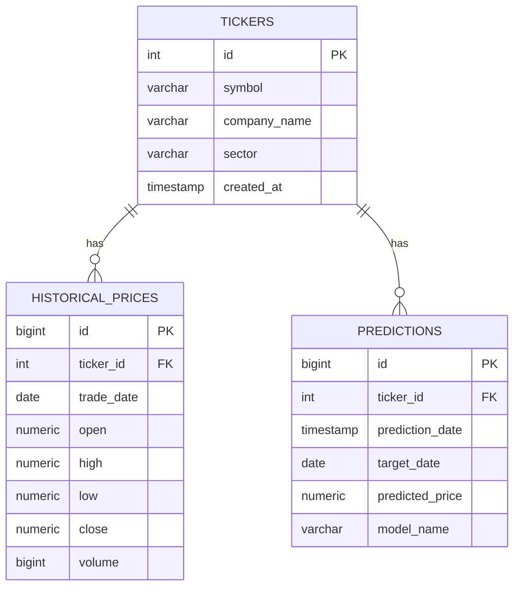

# Предсказание курса акций (задание по БД)

Учебный проект: ETL исторических котировок в PostgreSQL, прогноз цены моделью ARIMA
и веб-интерфейс на Streamlit.

Подробное описание устройства проекта (слои, функции, схема БД) — в
[ARCHITECTURE.md](ARCHITECTURE.md).

## Стек

| Слой | Технология |
|---|---|
| Хранилище | PostgreSQL 14+ |
| ETL | Python, `yfinance` |
| Модель | `statsmodels` (ARIMA), наивный бейзлайн |
| UI | Streamlit + Plotly |

## Структура проекта

```
.
├── app.py                 # Streamlit-интерфейс
├── etl/
│   ├── db.py              # конфигурация подключения к БД
│   ├── load_prices.py     # загрузка OHLCV из Yahoo Finance
│   └── predict.py         # обучение модели, прогноз, бэктест
├── sql/
│   ├── schema.sql         # таблицы, индексы, view latest_predictions
│   └── seed_tickers.sql   # справочник 30 тикеров
├── ARCHITECTURE.md        # архитектура, функции, схема БД
├── Dockerfile
├── docker-compose.yml
├── Makefile
└── requirements.txt
```

## Требования

* Python 3.10+
* PostgreSQL 14+ (локально или в Docker)
* Интернет — только для шага ETL (Yahoo Finance)

## Быстрый старт (macOS / Linux)

```bash
# 1. База данных
createdb stock_prediction
psql -d stock_prediction -f sql/schema.sql
psql -d stock_prediction -f sql/seed_tickers.sql

# 2. Зависимости
python3 -m venv .venv
source .venv/bin/activate
pip install -r requirements.txt

# 3. Данные (≈15 сек на 30 тикеров)
python -m etl.load_prices --period 5y

# 4. Интерфейс
streamlit run app.py        # http://localhost:8501
```

Через `make`:

```bash
make install && make db && make etl && make run
```

## Windows

Локальный unix-сокет и peer-аутентификация недоступны, поэтому параметры
подключения нужно задать явно:

```powershell
$env:DB_HOST="localhost"; $env:DB_USER="postgres"; $env:DB_PASSWORD="secret"
python -m etl.load_prices --period 5y
streamlit run app.py
```

## Docker

```bash
docker compose up --build -d
docker compose exec -T db psql -U stock -d stock_prediction < sql/schema.sql
docker compose exec -T db psql -U stock -d stock_prediction < sql/seed_tickers.sql
docker compose exec app python -m etl.load_prices --period 5y
# интерфейс: http://localhost:8501
```

## Конфигурация БД

Приоритет источников (см. `etl/db.py`):

1. `DATABASE_URL` — строка подключения целиком;
2. `DB_NAME`, `DB_HOST`, `DB_PORT`, `DB_USER`, `DB_PASSWORD`;
3. по умолчанию — локальный сокет и текущий пользователь ОС.

Пример — в `.env.example`.

## Что делает программа

1. **ETL (`etl/load_prices.py`)** — качает историю с Yahoo Finance и пишет в
   `historical_prices`. Повторный запуск не создаёт дублей: `ON CONFLICT
   (ticker_id, trade_date) DO UPDATE`. Цены берутся скорректированными на сплиты
   и дивиденды (`auto_adjust=True`). Ошибка по одному тикеру не роняет весь запуск.
2. **Прогноз (`etl/predict.py`)** — читает `close` за последние ~2 года, обучает
   модель и пишет результат в `predictions` через upsert
   `(ticker_id, model_name, target_date)`. Горизонт задаётся в **торговых** днях,
   выходные и праздники NYSE пропускаются. Считается бэктест (MAE / RMSE / MAPE)
   и сравнение с наивным прогнозом.
3. **Интерфейс (`app.py`)** — выбор тикера и модели, горизонт, график истории и
   прогноза, метрики качества, таблица последних прогнозов из БД.

Модели: `arima` — ARIMA(2, 1, 2) на уровнях цены; `naive` — «последняя известная
цена» (бейзлайн для сравнения).

```bash
python -m etl.predict --symbol AAPL --days 14 --model arima
python -m etl.predict --symbol AAPL --days 30 --model naive
```

## Схема БД

Три таблицы со связями (внешние ключи, `ON DELETE CASCADE`) и view
`latest_predictions` — последний прогноз по каждому тикеру и модели.



Ключевые ограничения:

* `historical_prices`: `UNIQUE (ticker_id, trade_date)` — идемпотентный ETL;
* `predictions`: `UNIQUE (ticker_id, model_name, target_date)` — пересчёт
  обновляет прогноз, а не копит дубли.

`schema.sql` идемпотентен: его можно применять повторно к существующей базе
(он сам уберёт устаревшие индексы/колонки и дубли).

## Решения по ходу разработки

* **Дубли при повторной загрузке** — решены через `ON CONFLICT (ticker_id,
  trade_date)`.
* **`No supported index` в statsmodels** — из-за «рваного» DatetimeIndex
  (выходные и праздники). Индекс сбрасывается перед обучением, а будущие даты
  генерируются отдельно по календарю NYSE.
* **`TypeError` при вычитании `Decimal` и `float`** — значения из БД явно
  приводятся к `float`.
* **Пропадающий прогноз в Streamlit** — каждый rerun перезапускает скрипт,
  поэтому результат хранится в `st.session_state`.
* **Одно соединение на всё приложение** — psycopg2 не потокобезопасен, а после
  ошибки транзакция остаётся в состоянии `aborted`. Теперь соединение
  открывается на запрос.

## Ограничения

* ARIMA(2,1,2) на уровнях цены — учебная модель; на длинном горизонте прогноз
  близок к случайному блужданию.
* Праздники NYSE учтены, но календарь зашит в код — при смене биржи его нужно
  заменить.
* Нет авторизации и истории версий прогнозов: на каждую пару
  (тикер, модель, дата) хранится только последний расчёт.
